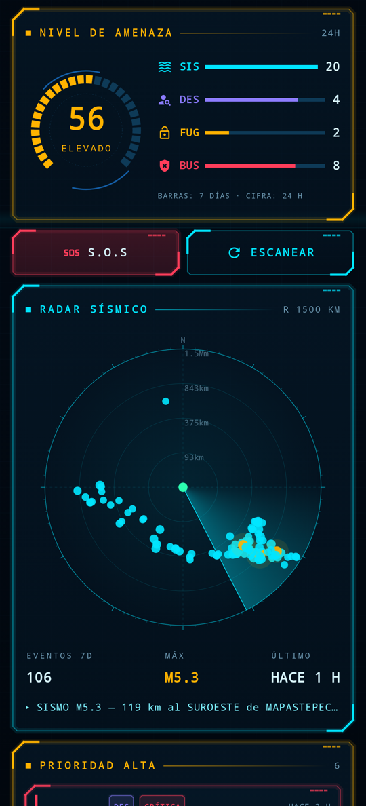
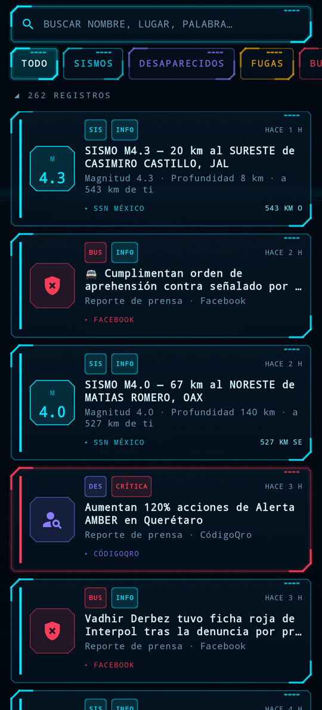
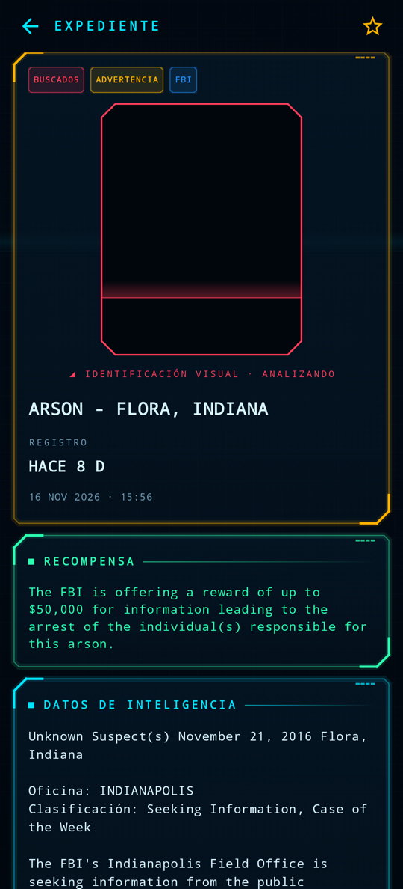
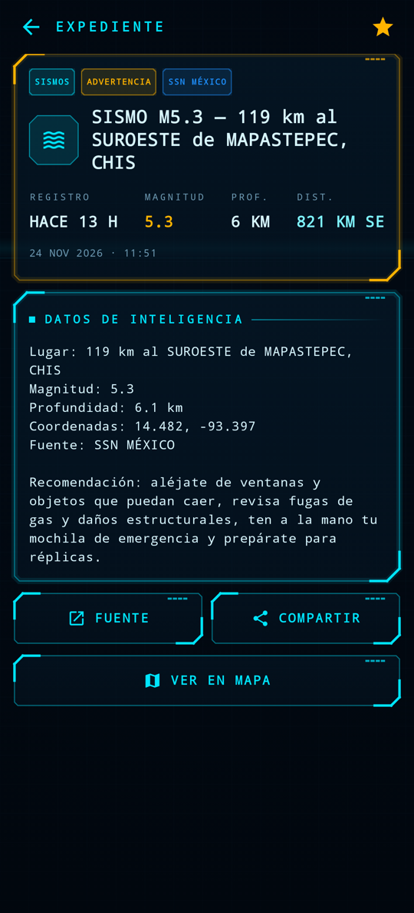
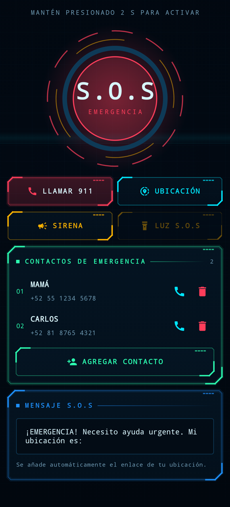
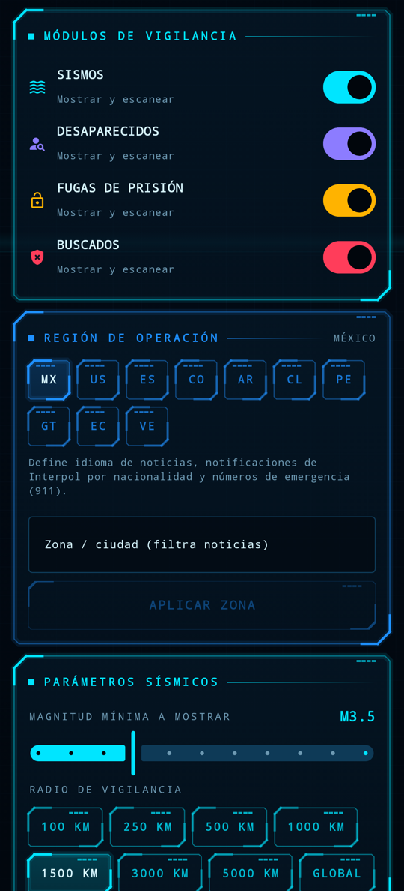

# CENTINELA — Sistema de Alerta Táctica (Android)

App de protección personal con interfaz HUD cibernética azul. Recibe alertas rápidas de:

| Módulo | Fuentes |
|---|---|
| **Sismos** | SSN México (UNAM), USGS, EMSC — fusionados y sin duplicados, con radar por distancia a ti |
| **Desaparecidos** | FBI (ViCAP / Missing Persons), Interpol notificaciones amarillas, noticias (Alerta Amber, Protocolo Alba, fichas de búsqueda) |
| **Fugas de prisión** | Noticias de fugas de reos / penales en tu región |
| **Buscados** | FBI Most Wanted (incl. Top 10), Interpol notificaciones rojas, noticias (órdenes de aprehensión, más buscados) |

## Funciones
- **HUD**: nivel de amenaza 0–100, conteo por categoría, radar sísmico animado, alertas prioritarias y estado de enlaces de datos.
- **Alertas**: buscador, filtros (sismos, desaparecidos, fugas, buscados, críticas, guardadas), deslizar para actualizar.
- **Expediente**: foto con escaneo, datos completos, recompensa, protocolo de seguridad, abrir fuente, compartir, ver en mapa, llamar al 911 / denuncia anónima 089.
- **S.O.S**: botón de mantener 2 s que envía SMS con tu ubicación GPS a tus contactos, llamada de emergencia, sirena, linterna en Morse S.O.S y compartir ubicación.
- **Notificaciones** en segundo plano (cada 15/30/60 min) y **modo en vivo** (cada 30 s–5 min con la app abierta). Canal crítico con sonido de alarma.
- **Ajustes**: módulos, región (MX, US, ES, CO, AR, CL, PE, GT, EC, VE), ciudad/zona para filtrar noticias, magnitud mínima, radio de vigilancia, umbrales de notificación.

## Instalar
- APK listo: [`apk/Centinela-v1.0.0.apk`](apk/Centinela-v1.0.0.apk) (Android 8.0+). Activa "Instalar apps desconocidas".
- O descarga el artefacto `centinela-apk` de GitHub Actions.

## Compilar
```bash
cd centinela-android
./gradlew assembleRelease   # requiere Android SDK 35 y JDK 17+
```

## Capturas
| | | |
|---|---|---|
|  |  |  |
|  |  |  |

> Centinela es una herramienta informativa: **no sustituye** a la alerta sísmica oficial (SASMEX), protección civil ni a la policía. Nunca intentes detener a una persona: repórtala a las autoridades.
